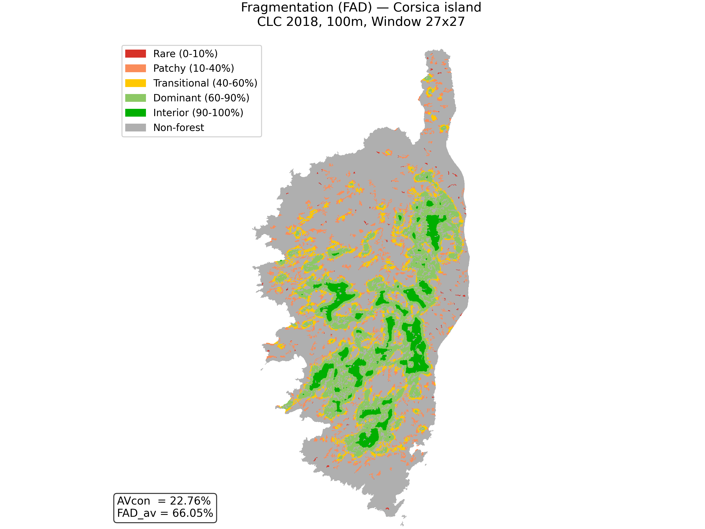
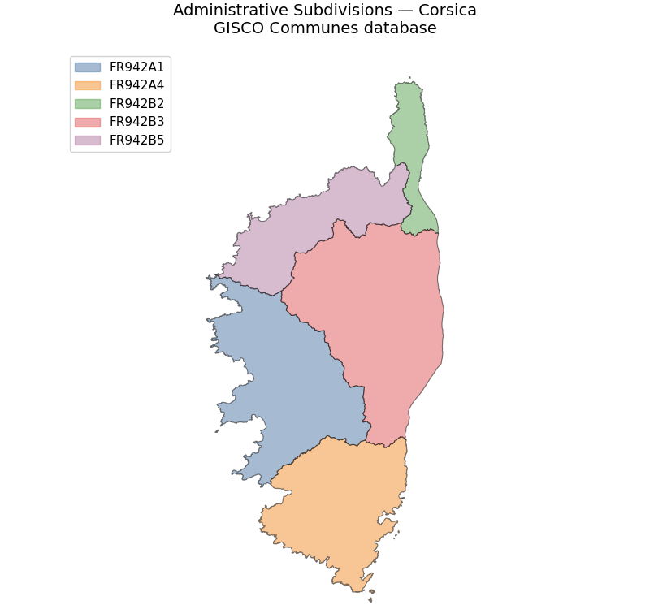
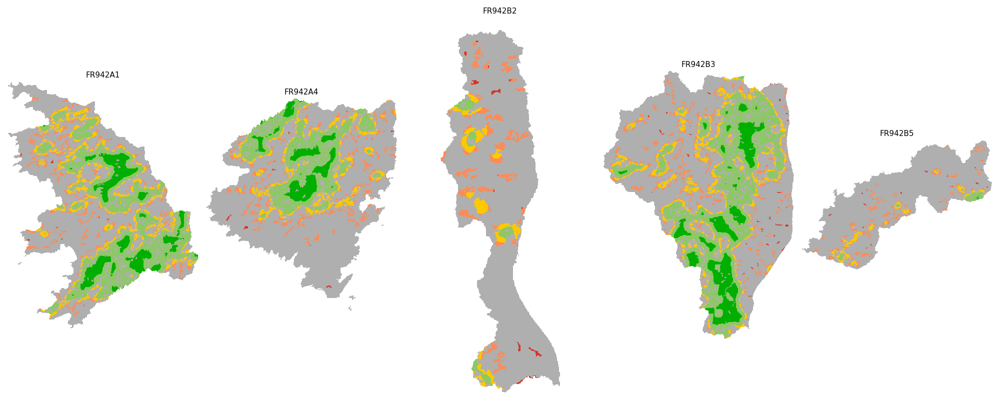

.. |pipeline| image:: https://code.europa.eu/jrc-forest/guidos/pyguidos/badges/main/pipeline.svg?ignore_skipped=true
   :target: https://code.europa.eu/jrc-forest/guidos/pyguidos/-/pipelines
   :alt: Pipeline Status

.. |coverage| image:: https://code.europa.eu/jrc-forest/guidos/pyguidos/badges/main/coverage.svg?job=run_tests
   :target: https://jrc-forest.pages.code.europa.eu/guidos/pyguidos/coverage/index.html
   :alt: Coverage Report

.. |docs| image:: https://img.shields.io/badge/docs-latest-brightgreen.svg
   :target: https://jrc-forest.pages.code.europa.eu/guidos/pyguidos/
   :alt: Documentation Status

.. |pypi| image:: https://img.shields.io/pypi/v/pyguidos.svg
   :target: https://pypi.org/project/pyguidos/
   :alt: PyPI Version

.. |downloads| image:: https://static.pepy.tech/badge/pyguidos
   :target: https://pepy.tech/project/pyguidos
   :alt: Downloads Counter

.. |license| image:: https://img.shields.io/badge/license-GPLv3-blue.svg
   :target: https://www.gnu.org/licenses/gpl-3.0.html
   :alt: GPLv3 License
   
.. |JOSS| image:: https://joss.theoj.org/papers/8a3fdc720f5b0c3f8392d33405787d79/status.svg
   :target: https://joss.theoj.org/papers/8a3fdc720f5b0c3f8392d33405787d79
   :alt: JOSS status

|pipeline| |coverage| |docs| |pypi| |downloads| |license| |JOSS|

Introduction
------------

**pyGuidos** is a Python implementation of the core spatial pattern analysis tools found in the `GuidosToolbox <https://forest.jrc.ec.europa.eu/en/activities/lpa/gtb/>`_ (GTB) desktop application and the `GuidosToolbox Workbench <https://forest.jrc.ec.europa.eu/en/activities/lpa/gwb/>`_ (GWB) command-line interface. By translating key analytical tools into native Python, ``pyGuidos`` removes proprietary runtime restrictions and platform limits, enabling seamless and reproducible landscape analysis workflows across Python scripts, Jupyter notebooks, and automated pipelines.

The official upstream development workspace for ``pyGuidos`` is hosted on `code.europa.eu <https://code.europa.eu/jrc-forest/guidos/pyguidos>`_, the open-source repository platform of the European Commission. Because this institutional forge restricts issue creation and merge requests to authorized internal accounts (EU Login), public community collaboration is mirrored to this `GitHub Repository <https://github.com/nonpenso/pyguidos/>`_. 
For bug reports and feature requests, please do not use the **code.europa.eu** tracker for feedback. Instead, use our public **GitHub Mirror** to report code anomalies or file tickets visiting the public `GitHub Issue Tracker <https://github.com/nonpenso/pyguidos/issues>`_, or to submit patches or open-source optimizations, opening a Pull Request against the public **GitHub Repository Mirror**. Approved code updates will be vetted by the maintainers and integrated into the primary downstream build cycle.

Statement of need
-----------------

Landscape analysis benefits from a wide array of existing software packages, desktop applications, and libraries, ranging from classic tools like FRAGSTATS and Circuitscape to various R packages and Python modules. However, a persistent challenge has been the programmatic automation of the established `GuidosToolbox <https://forest.jrc.ec.europa.eu/en/activities/lpa/gtb/>`_ desktop application developed at the European Commission Joint Research Centre (JRC). Historically, Guidos capabilities were confined first to the desktop application and later to the `GuidosToolbox Workbench <https://forest.jrc.ec.europa.eu/en/activities/lpa/gwb/>`_, which provides command-line access to the core Guidos tools but is strictly constrained to Linux systems, presenting architectural limitations that hindered integration into modern workflows. ``pyGuidos`` addresses this gap by reimplementing the core Guidos tools for spatial pattern analysis into a high-performance Python library. Accelerated with Numba JIT compilation and parallelized across CPU cores, it matches the performance of compiled C-binaries while offering complete cross-platform portability and seamless integration into automated data pipelines and Jupyter notebooks.

This technical evolution carries direct policy relevance, particularly in the context of the European Union Nature Restoration Regulation (NRR). The regulation legally requires EU Member States to report a forest connectivity index based on the Foreground Area Density (FAD) metric, driving an immediate demand for auditable and scalable software capable of computing FAD at national and continental scales. Because legacy Guidos architectures relied on proprietary runtimes and platform-restricted binaries, they were poorly suited for automated national reporting pipelines. PyGuidos fills this gap by implementing the exact FAD algorithm adopted for NRR compliance in pure, accessible Python code that can be deployed on any modern infrastructure.

Consequently, the package is designed to support a broad audience of landscape ecologists, remote sensing analysts, and forest monitoring practitioners across national forest services, international organizations, and European Commission bodies who require building reproducible analysis chains applying GuidoToolbox metrics to regional or global datasets for environmental policy reporting and spatial assessment.

Getting started
---------------

If you are new to pyGuidos, we recommend following these steps:

1. **Installation**: Follow the :doc:`installation` guide to set up the library.
2. **Interactive Help**: Use the built-in helper to explore available tools:

   .. code-block:: python

      import pyguidos as pg
      pg.info()

3. **User Guide**: Browse the :doc:`usage/index` for detailed examples of Landscape Mosaic, Fragmentation, and other analysis tools.

Usage example
-------------

This example demonstrates how to compute Forest Area Density (FAD) fragmentation statistics on a binary Forest/Non-Forest (FNF) raster and visualize the output using Matplotlib along with its embedded GTB colormap and calculated indices.

The first step runs the ``pg.frag`` module to evaluate forest fragmentation across the landscape. Using the Forest Area Density (FAD) method with a $27 \times 27$ pixel moving window, the function analyzes the spatial context around each forest pixel. Setting ``statists=True`` generates summary metrics for the entire area, including Average Connectivity (AVcon) and Average FAD (FAD_av), while writing the resulting classified raster directly to the specified output directory.

.. code-block:: python

   import pyguidos as pg
   from pathlib import Path
   import matplotlib.patches as mpatches
   import matplotlib.pyplot as plt
   import rasterio
   import pyogrio

   # Compute Fragmentation (FAD)
   fnf_tiff = pg.DATA_DIR / "CLC2018_corsica_FNF.tif"
   out_dir = Path("/users/work/data")

   frag_island = pg.frag(
       in_tiff=fnf_tiff,
       method="FAD",
       window_size=27,
       outdir=out_dir,
       statists=True,
       stat_files=True,
       verb=False,
   )

Once the calculation is complete, the resulting GeoTIFF is loaded alongside its embedded GTB colormap via ``pg.utils.get_tif_colormap()``. The fragmentation map is rendered using Matplotlib with custom legend patches matching the six Fragmentation classes (ranging from Rare to Interior forest). Finally, the summary statistics computed during the analysis are extracted from the output dictionary and displayed in an overlay box on the map.

.. code-block:: python

   # Read output data and embedded colormap
   frag_tiff = Path(frag_island['output paths']['path tif'])
   with rasterio.open(frag_tiff) as src:
       data_island = src.read(1)
   cmap_island, norm_island = pg.utils.get_tif_colormap(frag_tiff)

   # Create Map Visualization
   fig, ax = plt.subplots(figsize=(7, 9))
   ax.imshow(
       data_island, cmap=cmap_island, norm=norm_island, interpolation="none"
   )
   ax.set_title("Fragmentation (FAD) — Corsica island\nCLC 2018, 100m, Window 27x27",
       fontsize=13, pad=15)
   ax.axis("off")

   # Construct Custom Legend
   legend_patches_frag = [
       mpatches.Patch(color="#d73228", label="Rare (0-10%)"),
       mpatches.Patch(color="#fa8c5a", label="Patchy (10-40%)"),
       mpatches.Patch(color="#ffc800", label="Transitional (40-60%)"),
       mpatches.Patch(color="#8cc864", label="Dominant (60-90%)"),
       mpatches.Patch(color="#00af00", label="Interior (90-100%)"),
       mpatches.Patch(color="#afafaf", label="Non-forest"),
   ]
   ax.legend(handles=legend_patches_frag, loc="upper left", 
       bbox_to_anchor=(-0.5, 1.0), fontsize=10, framealpha=0.9)

   # Display Summary Metrics Box
   avcon_island = frag_island["output stats"]["avcon"]
   fad_island = frag_island["output stats"]["fad_av"]
   ax.text(-0.5, 0.02, f"AVcon  = {avcon_island:.2f}%\nFAD_av = {fad_island:.2f}%",
       transform=ax.transAxes, fontsize=11, verticalalignment="bottom",
       bbox=dict(boxstyle="round", facecolor="white", alpha=0.8),
   )

   plt.tight_layout()
   plt.show()

Vector datasets, such as administrative boundaries, can be integrated directly alongside spatial statistics workflows. In this step, the administrative subdivisions of Corsica are loaded from a GeoPackage using ``pyogrio`` into a GeoDataFrame and visualised using ``matplotlib``. 

.. code-block:: python

   # Load vector file containing administrative boundaries
   vector_file = pg.DATA_DIR / "GISCO_adm_corsica.gpkg"
   gdf = pyogrio.read_dataframe(vector_file)
   colors = ['#4e79a7', '#f28e2b', '#59a14f', '#e15759', '#b07aa1']
   gdf['plot_color'] = [colors[i % len(colors)] for i in range(len(gdf))]
   
   # Plot the vector file
   fig, ax = plt.subplots(figsize=(8, 8))
   gdf.plot(
       ax=ax,
       color=gdf['plot_color'],
       alpha=0.5,
       edgecolor='black',
       linewidth=0.8
   )
   
   legend_handles = []
   for i, name in enumerate(gdf[gdf.columns[0]].unique()[:len(colors)]):
       patch = mpatches.Patch(color=colors[i], alpha=0.5, label=name)
       legend_handles.append(patch)
   ax.legend(handles=legend_handles, loc='upper left', 
       bbox_to_anchor=(-0.5, 1.0), fontsize=11, framealpha=0.9)
   
   ax.set_title('Administrative Subdivisions — Corsica\nGISCO Communes database', fontsize=14, pad=15)
   ax.set_aspect('equal')
   ax.axis('off')
   
   plt.tight_layout()
   plt.show()

The final step extracts the fragmentation raster for each administrative region using ``pg.extract_by_polygon()``. The function clips the input GeoTIFF using the polygon geometries from the vector dataset, generating individual raster files for each zone identified by the ``ADM_ID`` field. The resulting subset rasters are then loaded and plotted side-by-side using Matplotlib subplots.

.. code-block:: python

   # Perform zonal extraction by administrative polygons
   pg.extract_by_polygon(
       vector_path=str(vector_file),
       geotiff_path=str(frag_island_tiff),
       output_dir=str(OUT_DIR),
       id_field='ADM_ID',
       name_prefix='FRAG_'
   )
   
   # Gather extracted GeoTIFF files
   region_frag_tiffs = sorted(OUT_DIR.glob('FRAG_*.tif'))
   n_regions = len(region_frag_tiffs)
   
   # Plot all extracted regions side-by-side
   fig, axes = plt.subplots(1, n_regions, figsize=(4 * n_regions, 8))
   for ax, tif in zip(axes, region_frag_tiffs):
       with rasterio.open(tif) as src:
           data = src.read(1)
       cmap, norm = pg.utils.get_tif_colormap(tif)
       region_name = tif.stem.replace('FRAG_', '')
       ax.imshow(data, cmap=cmap, norm=norm, interpolation='none')
       ax.set_title(region_name, fontsize=11)
       ax.axis('off')
   
   plt.tight_layout()
   plt.show()

Advanced Workflows & Tutorials
------------------------------

For more in-depth use cases, a complete suite of step-by-step example notebooks is available in the :ref:`Examples <examples>` section. These workflows guide you from raw data acquisition to final results generation:

* **01. Getting Started**: Basic raster handling, metadata extraction, and setup.
* **02. Landscape Mosaic**: Computing core landscape mosaic metrics.
* **03. Fragmentation Change**: Analyzing multi-temporal fragmentation changes.
* **04. Regional Analysis**: Extracting metrics by administrative subdivisions.
* **05. Grayscale Fragmentation**: Processing continuous raster inputs.
* **06. Morphology MSPA & SPA**: Executing Morphological Spatial Pattern Analysis.

You can browse these tutorials online or click the **"Open in Colab"** badge at the top of any notebook page to execute them interactively in your browser.

Memory usage and large rasters
------------------------------

pyGuidos loads each input raster fully into memory, so a tool's memory footprint
scales with the raster size. Peak usage differs by function, expressed here as a
multiple of the raw input size *R* (one byte per ``uint8`` pixel):

.. list-table::
   :header-rows: 1

   * - Function
     - Peak memory
     - Reason
   * - ``mspa``
     - ~25 × *R*
     - Multiple full-size morphological buffers in the C engine also depending on edge width
   * - ``spa``
     - ~10–15 × *R*
     - Several full-size morphological masks and distance transforms  depending on edge width
   * - ``frag``, ``frag_gray``, ``landmos``
     - ~3 × *R*
     - Input up-cast to int16 plus an output buffer
   * - ``acc``, ``rss``
     - ~4-5 × *R*
     - Adds a mask and a connected-component label array
   * - ``frag_change``
     - ~2 × *R*
     - Processed block by block via windowed reading

Physical RAM is not a hard limit: the effective ceiling is RAM plus swap or page-file space. Depending on the OS in use, rasters exceeding physical RAM may be transparently paged to disk and still complete processing, though at the expense of a significant performance penalty due to disk I/O. macOS comes preconfigured with compressed RAM, which transparently expands usable memory. A similar compressed-memory approach is supported natively in Linux via the standard `zram` kernel module. Moreover, configuring disk partitions or external drives as swap space provides additional virtual memory. Raster size is therefore primarily a trade-off with processing time and I/O bandwidth rather than a strict capacity ceiling.

Citation
--------

If you use **pyGuidos** in your research, please cite both the software implementation 
and the underlying scientific methodology:

Software implementation: pyGuidos
   * Caudullo G., Vogt P., Soille P. (2026). *pyGuidos: A Python implementation of Guidos spatial pattern analysis*. JOSS in review.

Methodology: GuidosToolbox
   * Vogt P., Riitters K. (2017). *GuidosToolbox: universal digital image object analysis*. European Journal of Remote Sensing, 50, 1, pp. 352-361. doi: `10.1080/22797254.2017.1330650 <https://doi.org/10.1080/22797254.2017.1330650>`_

Authors
-------

* **Giovanni Caudullo** - `giovanni.caudullo@ext.ec.europa.eu <mailto:giovanni.caudullo@ext.ec.europa.eu>`_
* **Peter Vogt** - `peter.vogt@ec.europa.eu <mailto:peter.vogt@ec.europa.eu>`_
* **Pierre Soille** - `pierre.soille@ec.europa.eu <mailto:pierre.soille@ec.europa.eu>`_

License
-------

pyGuidos is distributed under the **GNU General Public License v3 (GPLv3)**.
This is because the package bundles the GPLv3-licensed `miallib
<https://github.com/ec-jrc/jeolib-miallib>`_ MSPA engine of Soille and Vogt,
which is compiled into pyGuidos.

The original pyGuidos code (everything except the vendored ``miallib`` sources
under ``pyguidos/_mspa/miallib/``) remains available under the `European Union
Public Licence v1.2 (EUPL-1.2)
<https://joinup.ec.europa.eu/collection/eupl/eupl-text-eupl-12>`_, which is
compatible with the GPLv3.

For the full license text see the ``LICENSE`` file, and the ``NOTICE`` file
for attribution details.

.. toctree::
   :maxdepth: 2
   :hidden:
   :caption: Contents:

   installation
   usage/index
   examples/index
   contributing
   changelog